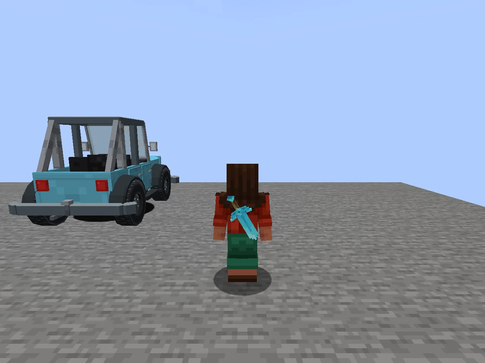
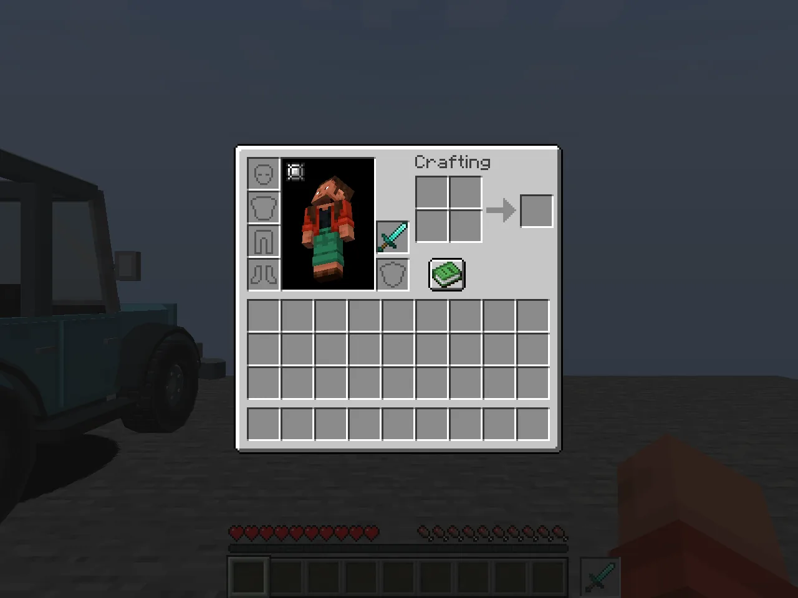
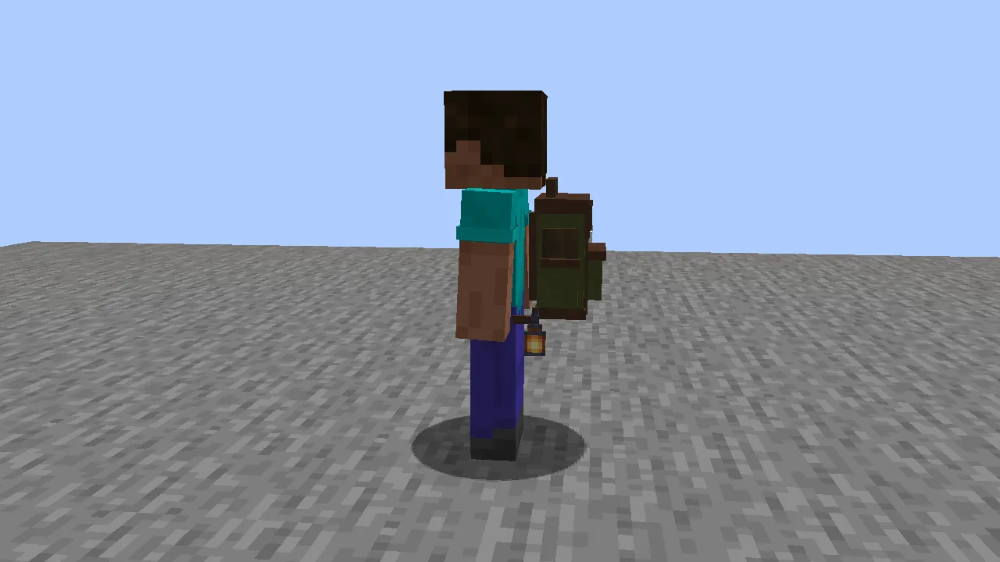

**One extra item slot.** Press **H** to swap it with the item in your hand: a sword for a pickaxe,
food for a torch. What's in it is worn on your body for everyone to see: big tools on your back,
small things on your belt.

## Using it

- **H** swaps the quick slot with the selected hotbar item, with a very quiet click. Rebind it under
  *Controls → Quick Slot*. Scrolling still covers just the nine hotbar slots.
- **While driving** a Vanilla Wheels vehicle, H is the headlights, so the quick slot is off.
  Passengers keep it.
- In your **inventory** the quick slot's cell sits directly above the offhand. Click, split and
  shift-click it like any slot. (In the creative inventory, use H: the cell can't be clicked there.)
- A small HUD cell beside your hotbar shows what's in it, with its count and durability.
- It keeps through saves and dimension travel. **On death it drops** with the rest of your inventory
  (unless the server keeps inventories).

## How it looks on you

- **Large tools and weapons** go on your back; **small items** on your belt. Food and potions get
  bottle, pouch or hanging styles. Exactly one item shows, whatever the stack size.
- **Hidden:** ordinary blocks, armour, bowl meals, and **everything while you wear an elytra**.
- With a [Backpacks+](/wiki/backpacks-plus) bag on, large back items hide and small ones move to the
  hip.
- With Luminance, a torch or lantern in the quick slot **lights up** your surroundings, as if held.

